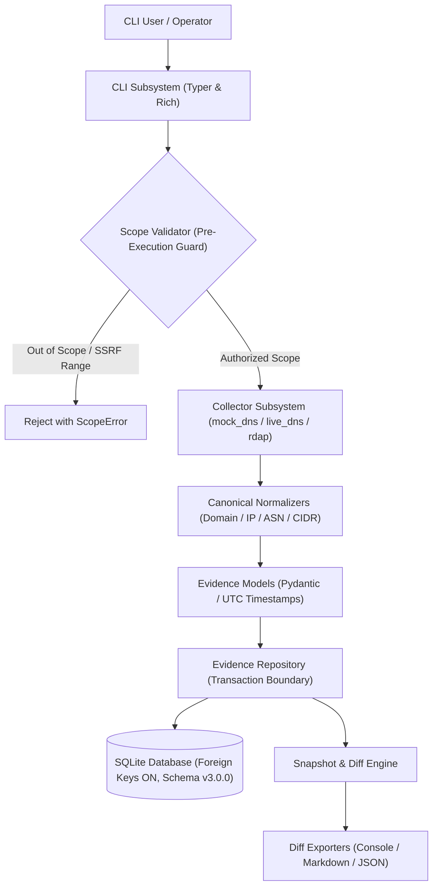

# TraceGraph

> **Local-first, evidence-first OSINT infrastructure intelligence platform.**

TraceGraph is an open-source defensive intelligence platform engineered for authorized security practitioners, network defenders, and incident responders.

Conventional OSINT and reconnaissance tools frequently aggregate external data without strict attribution, resulting in unverifiable inferences, ambiguous ownership claims, and hallucinations when ingested by automated or AI reasoning pipelines. TraceGraph solves this by enforcing an explicit **evidence-first invariant**: *no infrastructure entity relationship is presented as verified unless it is backed by concrete, immutable observation telemetry with full provenance.*

[](LICENSE)
[](https://www.python.org/downloads/)
[](CHANGELOG.md)
[](https://github.com/SultanGun/TraceGraph/actions/workflows/ci.yml)

---

## 📑 Table of Contents

- [Core Differentiators](#-core-differentiators)
- [System Architecture](#-system-architecture)
- [Installation & Requirements](#-installation--requirements)
- [Quick Start: End-to-End Walkthrough](#-quick-start-end-to-end-walkthrough)
- [Supported Collectors](#-supported-collectors)
- [CLI Reference](#-cli-reference)
- [Testing & Quality Assurance](#-testing--quality-assurance)
- [Current Alpha Status & Limitations](#-current-alpha-status--limitations)
- [Defensive Use & Scope Policy](#-defensive-use--scope-policy)
- [Contributing](#-contributing)
- [Documentation & License](#-documentation--license)

---

## 💡 Core Differentiators

- **Evidence Provenance:** Every observation explicitly records its originating collector identity, collector version, source URI or synthetic reference, observation timestamp (UTC), and ingestion timestamp (UTC). Unsupported relationships are marked `[UNVERIFIED]`.
- **Immutable Snapshots:** Investigations can capture point-in-time states of their evidence graph. Snapshots store canonical serialized content alongside a cryptographic SHA-256 content digest, verified on retrieval.
- **Temporal Graph Diff Engine:** Deterministic comparisons between snapshots within an investigation. Accurately categorizes added entities, unobserved assets, modified metadata, and evidence link changes, explicitly distinguishing *observed absence* from *absence of evidence*.
- **Pre-Execution Scope Enforcement:** Targets are strictly validated against declared scope boundaries (exact domains, wildcards, CIDRs, IPs) before any network query is initiated.
- **Defensive SSRF Guards & Privacy Protection:** Built-in safeguards reject private, loopback, link-local, multicast, and reserved IP ranges prior to socket connections. RDAP queries automatically redact individual personal contact data (vCards, personal emails, personal phone numbers).
- **Local Sovereignty:** All investigations, raw telemetry, entity linkages, and snapshots reside on your local machine in an ACID-compliant SQLite database with enforced foreign keys. No third-party cloud service or SaaS telemetry required.
- **AI-Ready Architecture:** Designed so future LLM agents and analytical systems are constrained to citing verifiable observation IDs from local storage rather than inventing speculative connections.

---

## 🏛️ System Architecture



### Core Data Concepts

| Concept | Description | Integrity Rule |
| :--- | :--- | :--- |
| **Investigation** | Defines an operational assessment boundary with a declared target scope. | Immutable created timestamp, unique UUIDv4. |
| **Entity** | Distinct infrastructure artifact (Domain, IPv4, IPv6, ASN, CIDR, Nameserver, Certificate). | Deduplicated globally by unique `(entity_type, canonical_value)` constraint. |
| **Observation** | Concrete telemetry collected by an identified collector. | Scoped to an investigation. Contains raw payload, status, and dual UTC timestamps (`observed_at`, `ingested_at`). |
| **Relationship** | Directional link between two entities (`RESOLVES_TO`, `BELONGS_TO`, `SERVED_BY`, etc.). | Unique directional edge constraint. Foreign key cascade to entities. |
| **Evidence Link** | Associative mapping between a Relationship and its supporting Observations. | **Provenance Invariant:** Marked `[VERIFIED]` only if supported by at least one active observation in the investigation. |
| **Snapshot** | Immutable point-in-time capture of an investigation's evidence graph. | Canonical JSON payload protected by a verified SHA-256 content digest. |

---

## 📦 Installation & Requirements

### Prerequisites

- **Python:** 3.12 or higher (tested on Python 3.12, 3.13, and 3.14)
- **SQLite:** 3.35+ (bundled standard with modern Python releases)
- **Operating Systems:** Linux, macOS, Windows

### Setup

Clone the repository and install TraceGraph in editable mode:

```bash
git clone https://github.com/tracegraph/tracegraph.git
cd tracegraph

# Standard installation
pip install -e .

# Development installation (includes pytest, pytest-cov, ruff)
pip install -e ".[dev]"
```

Verify your installation:

```bash
tracegraph version
```

---

## 🚀 Quick Start: End-to-End Walkthrough

This reproducible walkthrough demonstrates the complete TraceGraph investigation lifecycle:
**Initialize → Scope → Collect → Snapshot → Diff → Export**.

To ensure 100% offline reproducibility without external network dependencies, this example utilizes the deterministic `mock_dns` collector.

### Step 1: Initialize Workspace

Create a local investigation workspace and initialize the SQLite database (schema v3.0.0):

```bash
tracegraph init
```

Verify database connectivity and foreign-key enforcement:

```bash
tracegraph status
```

### Step 2: Establish Investigation Scope

Create an investigation defining the permitted target boundary:

```bash
tracegraph investigate new "Acme Security Audit" \
  --scope "example.com" \
  --desc "Baseline perimeter assessment"
```

### Step 3: Collect Baseline Evidence (Offline Synthetic)

Run the deterministic `mock_dns` collector against the authorized target:

```bash
tracegraph collect example.com --collector mock_dns
```

*Note: If only one investigation exists in the workspace, it is selected automatically.*

### Step 4: Capture Baseline Snapshot

Capture an immutable point-in-time snapshot of the investigation graph:

```bash
tracegraph snapshot create --label "Baseline Scan"
```

List snapshots to retrieve the snapshot ID:

```bash
tracegraph snapshot list
```

Verify the cryptographic SHA-256 content digest of your snapshot:

```bash
tracegraph snapshot show <SNAPSHOT_1_ID> --verify
```

*(TraceGraph supports unique 8-character ID prefixes such as `snap-a1b2c3d4` or full UUIDs).*

### Step 5: Collect Additional Evidence

Simulate infrastructure discovery by collecting subdomains within the authorized scope:

```bash
tracegraph collect sub.example.com --collector mock_dns
```

### Step 6: Capture Follow-Up Snapshot

Capture a second snapshot reflecting the expanded evidence graph:

```bash
tracegraph snapshot create --label "Subdomain Expansion"
```

### Step 7: Compare Snapshots (Diff Engine)

Compare the baseline snapshot against the expanded snapshot:

```bash
# Terminal comparison with formatted table
tracegraph snapshot diff <SNAPSHOT_1_ID> <SNAPSHOT_2_ID>

# Export comparison to Markdown
tracegraph snapshot diff <SNAPSHOT_1_ID> <SNAPSHOT_2_ID> --format markdown --output diff_report.md

# Export comparison to structured JSON
tracegraph snapshot diff <SNAPSHOT_1_ID> <SNAPSHOT_2_ID> --format json --output diff_export.json
```

### Step 8: Generate Full Investigation Report

Compile an evidence-backed Markdown investigation report citing all observations and verified linkages:

```bash
tracegraph report <INVESTIGATION_ID> --output investigation_report.md
```

---

## 🔍 Supported Collectors

TraceGraph strictly distinguishes between **synthetic offline fixtures** and **real live telemetry**:

```
                          ┌──────────────────────────┐
                          │ Supported Collectors     │
                          └─────────────┬────────────┘
                                        │
                 ┌──────────────────────┴──────────────────────┐
                 ▼                                             ▼
     [ Synthetic / Offline ]                         [ Real Live Network ]
      • mock_dns                                      • live_dns
        (Deterministic test fixture,                   (Authoritative DNS resolution:
         no network queries, exact                      A, AAAA, MX, NS records)
         synthetic:// provenance)                     • rdap
                                                       (RFC 7484 IP registry routing,
                                                        CIDR/ASN allocations, SSRF
                                                        defense, vCard PII redaction)
```

### 1. `mock_dns` (Synthetic / Offline)
- **Purpose:** Fully deterministic test collector for reproducible demos, unit testing, and offline verification without network access.
- **Output:** Synthesizes `A`, `AAAA`, `MX`, and `NS` records for `example.com` subdomains with explicit `synthetic://mock-dns/<target>` provenance.
- **Command:**
  ```bash
  tracegraph collect example.com --collector mock_dns
  ```

### 2. `live_dns` (Real Live DNS Resolution)
- **Purpose:** Queries live authoritative or configured recursive DNS resolvers.
- **Records Resolved:** `A` (IPv4), `AAAA` (IPv6), `NS` (Nameservers), and `MX` (Mail Exchangers).
- **Relationships Created:** `RESOLVES_TO` and `SERVED_BY`.
- **Operational Boundary:** Performs direct forward DNS resolution only. Does not perform brute-force subdomain enumeration or aggressive zone-transfer probes.
- **Command:**
  ```bash
  tracegraph collect example.com --collector live_dns
  ```

### 3. `rdap` (Real Public IP Registry Allocation)
- **Purpose:** Queries public Registration Data Access Protocol (RDAP) endpoints via RFC 7484 bootstrap routing (ARIN, RIPE NCC, APNIC, LACNIC, AFRINIC).
- **Entities Discovered:** Parent CIDR network blocks and Autonomous Systems (`ASN`).
- **Relationships Created:** `BELONGS_TO`.
- **Safety & Privacy Boundaries:**
  - **SSRF Defense:** Rejects private (RFC 1918), loopback (RFC 1122), link-local, multicast, documentation (RFC 5737), and reserved ranges before socket creation.
  - **PII Scrubbing:** Automatically strips individual contact details (`vcardArray`, contact names, personal phone numbers, and email addresses) to preserve operational privacy.
- **Command:**
  ```bash
  tracegraph collect 93.184.215.14 --collector rdap
  ```

---

## 🛠️ CLI Reference

### Global Options

```
tracegraph [OPTIONS] COMMAND [ARGS]...

Options:
  --version, -v   Display installed TraceGraph version.
  --help          Show help message and exit.
```

### Commands

| Command | Usage | Description |
| :--- | :--- | :--- |
| `version` | `tracegraph version` | Display installed software version. |
| `init` | `tracegraph init [-w <dir>]` | Initialize local workspace and SQLite database. Idempotent. |
| `status` | `tracegraph status [-w <dir>]` | Inspect workspace path, database connectivity, schema version, and entity/snapshot counts. |
| `investigate new` | `tracegraph investigate new <name> [-s <scope>] [-d <desc>] [-w <dir>]` | Establish a new investigation boundary and declared target scope. |
| `investigate list` | `tracegraph investigate list [-w <dir>]` | List all investigations in the active workspace. |
| `investigate show` | `tracegraph investigate show <id> [-w <dir>]` | Display detailed metadata and entity metrics for an investigation. |
| `collect` | `tracegraph collect <target> -c <collector> [-i <id>] [-w <dir>]` | Execute bounded data collection against target within declared scope. Collectors: `live_dns`, `rdap`, `mock_dns`. |
| `report` | `tracegraph report <investigation_id> [-o <file>] [-w <dir>]` | Generate an evidence-backed Markdown investigation report. |
| `snapshot create` | `tracegraph snapshot create [investigation_id] [-l <label>] [-w <dir>]` | Capture an immutable evidence graph snapshot. Auto-selects if 1 investigation exists. |
| `snapshot list` | `tracegraph snapshot list [-i <investigation_id>] [-w <dir>]` | List captured snapshots with entity counts, relationship counts, and digests. |
| `snapshot show` | `tracegraph snapshot show <snapshot_id> [--verify] [-w <dir>]` | Inspect snapshot metadata. `--verify` recomputes canonical SHA-256 digest. Accepts $\ge 8$-char prefix. |
| `snapshot diff` | `tracegraph snapshot diff <snap_a> <snap_b> [-f console\|markdown\|json] [-o <file>] [-w <dir>]` | Compare two snapshots within the same investigation. Accepts $\ge 8$-char prefixes. |

---

## 🧪 Testing & Quality Assurance

TraceGraph maintains rigorous test coverage with strict typing and static linting.

### Run Test Suite

```bash
# Run unit and integration tests
pytest

# Run tests with statement coverage report
pytest --cov=tracegraph
```

### Static Analysis & Linting

```bash
# Check code style and rules
ruff check .

# Apply safe automated fixes
ruff check . --fix
```

### Continuous Integration

Every commit and pull request targeting `master` is automatically validated on GitHub Actions across:
- Clean linting (`ruff check .`)
- Full test suite execution (`pytest`)
- Dependency caching via `.github/workflows/ci.yml`

---

## 🚧 Current Alpha Status & Limitations

TraceGraph is currently in active **v0.3.0-alpha** release. While the core evidence models, storage architecture, and diff engines are stable and thoroughly tested, users should note the following current boundaries:

- **Single-Node Local Storage:** Built on local SQLite. Distributed databases or multi-user synchronized backends are not currently supported.
- **CLI Interface:** Operational workflows are command-line driven. No graphical interface, web dashboard, or REST API server is currently provided.
- **Active Collectors:** Limited to live DNS resolution (`live_dns`) and IP registry queries (`rdap`). Additional collectors (Certificate Transparency, passive DNS, routing registries) are slated for future releases.
- **Investigation Diff Boundary:** Snapshot diffs are strictly restricted to snapshots from the *same* investigation. Comparing snapshots from different investigations is intentionally blocked to prevent cross-scope provenance pollution.
- **Synchronous Rate Limiting:** Outbound queries adhere to conservative synchronous delays rather than distributed rate-limiting queues.

---

## 🛡️ Defensive Use & Scope Policy

TraceGraph is engineered strictly for authorized security assessments, defensive posture auditing, and incident triage.

1. **Explicit Scope Authorization:** Only collect telemetry against domains, subnets, and infrastructure assets you own or have explicit, documented authorization to assess.
2. **Passive & Controlled Probing:** TraceGraph does not perform active vulnerability exploitation, denial-of-service tests, port scanning, or intrusive brute-forcing.
3. **Data Privacy & Compliance:** Investigators are responsible for ensuring that all collected infrastructure telemetry complies with applicable regional privacy and data protection frameworks.

---

## 🤝 Contributing

Contributions to TraceGraph are welcome! Please adhere to our development standards:

1. **Branch Strategy:** Work on dedicated feature branches (`feat/<feature-name>`, `fix/<bug-name>`, `audit/<audit-focus>`).
2. **Evidence Preservation:** Architectural changes must never violate the evidence-first invariant. Relationships must always link to supporting observations.
3. **Test-Driven Changes:** All code changes must be accompanied by relevant unit and integration tests in `tests/`.
4. **Code Quality:** Ensure all tests pass and code adheres to formatting rules before submitting pull requests:
   ```bash
   ruff check .
   pytest
   ```

---

## 📚 Documentation & License

For in-depth architectural and design documentation:
- [Architecture & Design Principles](docs/architecture.md)
- [Evidence Data Model & Schema](docs/data-model.md)
- [Threat Model & Defensive Boundaries](docs/threat-model.md)
- [Release Changelog](CHANGELOG.md)

Distributed under the **MIT License**. See [LICENSE](LICENSE) for full details.
