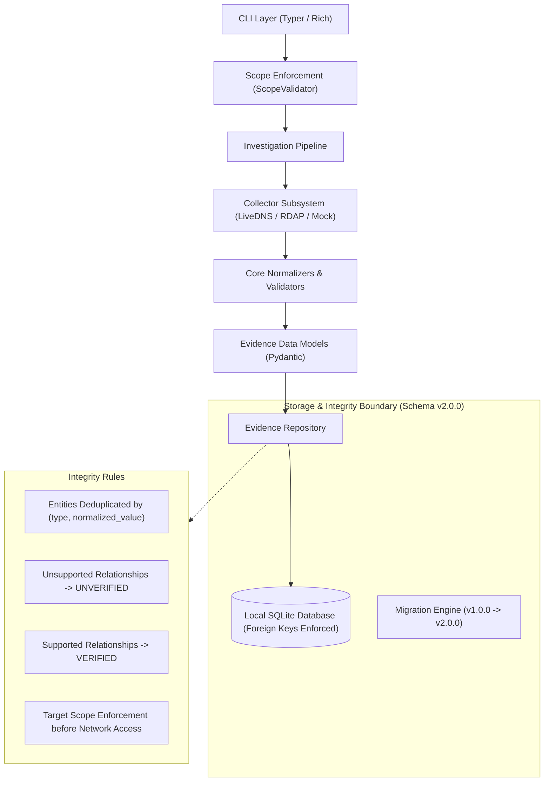

# TraceGraph Architecture

> **Local-first, evidence-first OSINT infrastructure intelligence platform.**

## 1. Architectural Philosophy

TraceGraph is engineered for authorized, defensive investigations of internet infrastructure. In conventional OSINT tooling, relationships between assets (such as domains, IPs, autonomous systems, and certificates) are often aggregated without strict attribution, resulting in untraceable inferences or hallucinated connections when paired with AI systems.

TraceGraph establishes a strict **evidence-first invariant**:
> *No entity relationship can be presented as verified unless it is directly supported by immutable observation telemetry with full provenance.*

---

## 2. Core Pillars

### 2.1 Evidence Provenance
Every observation stored in TraceGraph contains:
- **Collector Identity and Version:** The exact software unit that performed the collection.
- **Source Reference:** The source artifact URI or synthetic fixture (e.g. `synthetic://mock-dns/example.com`).
- **Observation Timestamp:** The exact UTC timestamp when the observation occurred.
- **Ingestion Timestamp:** The UTC timestamp when the record entered local storage.
- **Observed Data:** Raw, unmanipulated structured telemetry.

### 2.2 Reproducible Investigations
Investigations define clear scope boundaries. All observations, entities, and relationship links are stored locally inside transactional SQLite storage. The state of an investigation can be fully audited, replayed, and inspected without depending on ephemeral external SaaS platforms.

### 2.3 Temporal Intelligence
Infrastructure moves across time. TraceGraph distinguishes between:
- **Observation Time (`observed_at`):** When the external artifact or DNS query occurred.
- **Ingestion Time (`ingested_at`):** When the TraceGraph system ingested and normalized the data.
This separation allows future snapshot comparisons to detect infrastructure migrations, IP reassignments, and CDN changes over time.

### 2.4 AI-Ready Architecture
Future machine learning and agentic workflows must interact with TraceGraph through strict citation constraints:
- AI agents cannot insert relationships directly without attaching supporting observations.
- Analysis outputs must cite the underlying `observation_id`.
- If supporting evidence is missing, the relationship must display as `[UNVERIFIED]`.

---

## 3. Subsystem Breakdown

### 3.1 CLI Layer (`src/tracegraph/cli/`)
Built with Typer and Rich. Exposes high-level commands:
- `tracegraph version`: Reports installed version (`v0.2.0-alpha`).
- `tracegraph init`: Bootstraps local workspace and database with idempotency safeguards and auto-migration.
- `tracegraph status`: Inspects database connectivity, foreign-key enforcement, and schema version.
- `tracegraph investigate new <name> [--scope <scope>]`: Registers an investigation scope boundary.
- `tracegraph investigate list`: Lists all active workspace investigations.
- `tracegraph investigate show <id>`: Displays detailed investigation parameters and observation counters.
- `tracegraph collect <target> --collector <name>`: Runs bounded collection against target within declared scope.
- `tracegraph report <investigation-id> [--output <file>]`: Compiles comprehensive evidence-backed Markdown report.

### 3.2 Core & Normalizers (`src/tracegraph/core/`)
- **Enumerations (`enums.py`):** Canonical types for entities (`DOMAIN`, `IPV4`, `IPV6`, `ASN`, `CIDR`, `NAMESERVER`, `CERTIFICATE`, `URL`), relationships (`RESOLVES_TO`, `HOSTED_ON`, `BELONGS_TO`, `SUBDOMAIN_OF`, `SERVED_BY`, `MAIL_EXCHANGER_FOR`, `CERTIFIED_BY`, `ASSOCIATED_WITH`), and collection outcomes (`SUCCESS`, `EMPTY`, `FAILED`, `TIMEOUT`).
- **Normalizers (`normalizers.py`):** Converts raw user inputs and collector artifacts into canonical representation to eliminate duplicates (e.g., lowercase FQDNs, canonical IP strings via `ipaddress`, canonical `AS<number>`, canonical CIDR blocks).
- **Scope Validator (`scope.py`):** Pre-execution target authorization engine. Validates targets against declared scopes (exact domain, wildcard `*.domain`, exact IP, CIDR subnet, or unrestricted `*`). Implements strict RFC-compliant SSRF guards to block requests to private, loopback, or reserved IP spaces.
- **Exceptions (`exceptions.py`):** Domain error hierarchy ensuring clear error propagation (`ScopeError`, `MigrationError`, `CollectorError`, etc.).

### 3.3 Evidence Data Model (`src/tracegraph/evidence/`)
- Pydantic models for `InvestigationModel`, `EntityModel`, `ObservationModel`, `RelationshipModel`, and `EvidenceLinkModel`.
- Enforces UTC timezone awareness on all timestamps.
- Records `investigation_id` on observations and `target_scope` on investigations.
- Implements `RelationshipModel.is_verified` calculated from supporting observation links.

### 3.4 Storage Subsystem (`src/tracegraph/storage/`)
- **Database Engine (`database.py`):** SQLite connection pool with listener enforcing `PRAGMA foreign_keys = ON;`.
- **Relational Schema (`schema.py`):** SQLAlchemy declarative models with foreign key cascades, unique constraints, and indexes. Schema version 2.0.0 associates observations with investigations.
- **Migration Engine (`migrations.py`):** Automated, transactional schema migrations from v1.0.0 to v2.0.0. Safely adds columns, indexes, and preserves legacy observations by backfilling them into an auto-created legacy migration investigation.
- **Repository (`repository.py`):** Atomically manages entity deduplication, observation logging, relationship generation, and evidence joins.
- **Workspace Lifecycle (`workspace.py`):** Validates database integrity before connection, enforces schema versioning, and provides idempotency.

### 3.5 Collectors Subsystem (`src/tracegraph/collectors/`)
- **BaseCollector (`base.py`):** Abstract class defining input validation, timeout enforcement, duration measurement, and structured `CollectorResult`.
- **LiveDNSCollector (`dns.py`):** Real, bounded DNS resolution collector using `dnspython`. Queries `A`, `AAAA`, `NS`, and `MX` records against configurable resolvers. Normalizes discovered entities and creates `RESOLVES_TO`, `SERVED_BY`, and `MAIL_EXCHANGER_FOR` relationships.
- **RDAPCollector (`rdap.py`):** Bounded public IP RDAP client using `httpx`. Routes queries via RFC 7484 bootstrap services. Blocks SSRF attempts to private/reserved ranges, enforces HTTPS-only redirects (max 3), rate limits requests, enforces 512 KB response limits, and strips personal vCard contact information (PII). Discovers CIDR allocations and creates `BELONGS_TO` relationships.
- **MockDNSCollector (`mock.py`):** Deterministic synthetic collector for offline testing and verification without making external network requests.

### 3.6 Reporting Subsystem (`src/tracegraph/reports/`)
- Generates structured Markdown and terminal-rendered reports with metrics, declared scopes, collector provenance logs, discovered entity lists, and relationship verification tables annotated with `[VERIFIED]` / `[UNVERIFIED]` status badges and observation IDs.

---

## 4. Storage & Reliability Guarantees

1. **Foreign Key Enforcement:** SQLite does not enforce foreign keys by default. TraceGraph enforces `PRAGMA foreign_keys = ON;` on every connection via SQLAlchemy event listeners.
2. **Transaction Safety:** All multi-step write operations (e.g. creating relationships and linking observations) run inside `session_scope` context managers that automatically rollback on error.
3. **Safe Initialization:** `tracegraph init` will never overwrite or truncate an existing healthy database. If an existing database is corrupted, initialization fails cleanly with an explanatory diagnostic message rather than wiping the file.
