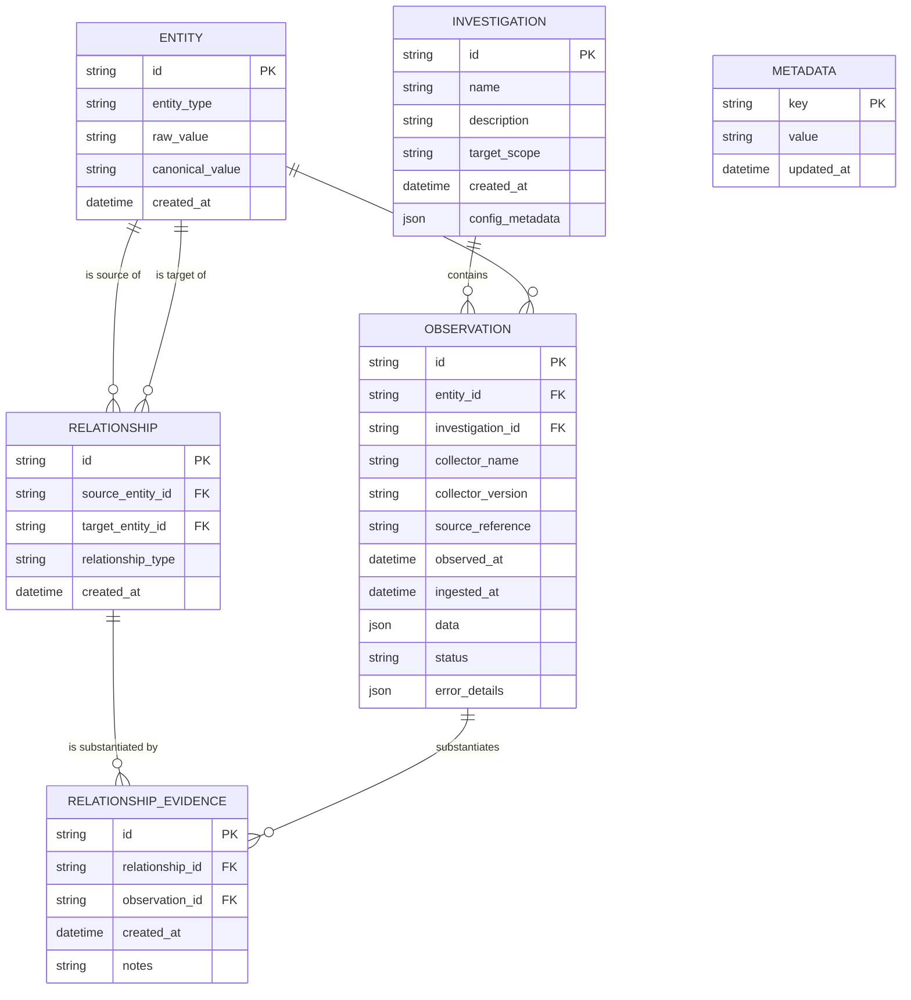

# TraceGraph Data Model & Evidence Schema

This document details the relational schema, entity validation rules, deduplication strategy, and evidence provenance invariants implemented in TraceGraph.

---

## 1. Entity-Relationship Overview

---

## 2. Table Specifications

### 2.1 `investigations`
Tracks discrete scoping boundaries and investigation parameters.

| Column | Type | Nullable | Description |
| :--- | :--- | :--- | :--- |
| `id` | VARCHAR(36) | NO | Primary Key (UUIDv4). |
| `name` | VARCHAR(255) | NO | Investigation title or reference code. |
| `description` | TEXT | YES | Objective, scope notes, or incident ticket. |
| `target_scope` | TEXT | NO | Declared target scope definition (e.g. `example.com, 93.184.215.0/24`). Default `""` (unrestricted). |
| `created_at` | DATETIME | NO | UTC creation timestamp. |
| `config_metadata`| JSON | NO | Parameters, allowed target scopes, and tags. |

### 2.2 `entities`
Represents infrastructure nodes.

| Column | Type | Nullable | Description |
| :--- | :--- | :--- | :--- |
| `id` | VARCHAR(36) | NO | Primary Key (UUIDv4). |
| `entity_type` | VARCHAR(50) | NO | Classification (`DOMAIN`, `IPV4`, `IPV6`, `ASN`, `CIDR`, `NAMESERVER`, etc.). |
| `raw_value` | VARCHAR(1024) | NO | Original input as provided by user or collector. |
| `canonical_value` | VARCHAR(1024) | NO | Canonicalized representation used for deduplication. |
| `created_at` | DATETIME | NO | UTC registration timestamp. |

**Constraints & Indexes:**
- `UNIQUE(entity_type, canonical_value)`: Prevents duplicate entity insertion across the workspace.
- `INDEX(entity_type, canonical_value)`: Fast lookup during ingestion.

### 2.3 `observations`
Discrete evidence collected from an identified source.

| Column | Type | Nullable | Description |
| :--- | :--- | :--- | :--- |
| `id` | VARCHAR(36) | NO | Primary Key (UUIDv4). |
| `entity_id` | VARCHAR(36) | NO | Foreign Key to `entities.id` (ON DELETE CASCADE). |
| `investigation_id` | VARCHAR(36) | YES | Foreign Key to `investigations.id` (ON DELETE CASCADE). Indexed. |
| `collector_name` | VARCHAR(100) | NO | Collector identity (e.g. `live_dns`, `rdap`, `mock_dns`). |
| `collector_version`| VARCHAR(50) | NO | Collector semver version. |
| `source_reference` | VARCHAR(1024) | NO | Provenance URI, resolver, or registry URL. |
| `observed_at` | DATETIME | NO | UTC timestamp when observed at source. |
| `ingested_at` | DATETIME | NO | UTC timestamp when stored locally. |
| `data` | JSON | NO | Raw structured telemetry payload. |
| `status` | VARCHAR(20) | NO | `SUCCESS`, `EMPTY`, `FAILED`, or `TIMEOUT`. |
| `error_details` | JSON | YES | Diagnostic information if status is not `SUCCESS`. |

### 2.4 `relationships`
Directional link between two infrastructure entities.

| Column | Type | Nullable | Description |
| :--- | :--- | :--- | :--- |
| `id` | VARCHAR(36) | NO | Primary Key (UUIDv4). |
| `source_entity_id` | VARCHAR(36) | NO | Foreign Key to `entities.id` (ON DELETE CASCADE). |
| `target_entity_id` | VARCHAR(36) | NO | Foreign Key to `entities.id` (ON DELETE CASCADE). |
| `relationship_type`| VARCHAR(50) | NO | Relationship verb (`RESOLVES_TO`, `HOSTED_ON`, etc.). |
| `created_at` | DATETIME | NO | UTC timestamp of relationship registration. |

**Constraints & Indexes:**
- `UNIQUE(source_entity_id, target_entity_id, relationship_type)`: Prevents duplicate edges.

### 2.5 `relationship_evidence`
Join table connecting a relationship to its supporting observation records.

| Column | Type | Nullable | Description |
| :--- | :--- | :--- | :--- |
| `id` | VARCHAR(36) | NO | Primary Key (UUIDv4). |
| `relationship_id` | VARCHAR(36) | NO | Foreign Key to `relationships.id` (ON DELETE CASCADE). |
| `observation_id` | VARCHAR(36) | NO | Foreign Key to `observations.id` (ON DELETE CASCADE). |
| `created_at` | DATETIME | NO | UTC timestamp of evidence association. |
| `notes` | TEXT | YES | Analyst extraction notes. |

**Constraints:**
- `UNIQUE(relationship_id, observation_id)`: Prevents redundant linking.

### 2.6 `metadata`
Key-value workspace configuration and schema state.

| Column | Type | Nullable | Description |
| :--- | :--- | :--- | :--- |
| `key` | VARCHAR(100) | NO | Primary Key (e.g. `schema_version`). |
| `value` | TEXT | NO | Associated configuration value. |
| `updated_at` | DATETIME | NO | UTC update timestamp. |

---

## 3. Provenance & Verification Rules

1. **Unsupported Edge Invariant:** A relationship without at least one linked row in `relationship_evidence` evaluates `is_verified = False`. The platform must never label an unlinked relationship as verified.
2. **Cascading Integrity:** Deleting an entity cascades and deletes its dependent observations and relationships. Deleting an observation removes its corresponding evidence link rows without destroying the underlying entities.
3. **Temporal Distinction:**
   - `observed_at` represents real-world timestamp of the artifact.
   - `ingested_at` represents storage time in TraceGraph.
   This guarantees that historical replays and imported archives maintain truthful telemetry timelines.

---

## 4. Normalization Rules

| Entity Type | Input Example | Normalized Output | Strategy |
| :--- | :--- | :--- | :--- |
| `DOMAIN` | ` Example.COM. ` | `example.com` | Strip, lower, rstrip trailing dot, IDNA encoding. |
| `IPV4` | ` 093.184.215.014 ` | `93.184.215.14` | Canonical dotted-decimal via `ipaddress.IPv4Address`. |
| `IPV6` | ` 2606:2800:0220:0001:0248:1893:25C8:1946 ` | `2606:2800:220:1:248:1893:25c8:1946` | Canonical lowercase compressed via `ipaddress.IPv6Address`. |
| `ASN` | ` as15169 ` | `AS15169` | Canonical uppercase `AS` prefix + integer. |
| `CIDR` | ` 192.168.1.1/24 ` | `192.168.1.0/24` | Network representation via `ipaddress.ip_network(strict=False)`. |
| `NAMESERVER` | ` NS1.EXAMPLE.COM ` | `ns1.example.com` | Lowercase FQDN. |
| `CERTIFICATE`| ` aa:bb:cc:dd ` | `AABBCCDD` | Strip colons/spaces, uppercase hex fingerprint. |

---

## 5. Schema Versioning & Migrations

TraceGraph uses explicit, versioned relational schema tracking via the `metadata` table.

### Schema Version History
- **v1.0.0 (v0.1.0-alpha):** Initial foundation with unassociated observations and implicit investigation boundaries.
- **v2.0.0 (v0.2.0-alpha):** Added `target_scope` column to `investigations` and `investigation_id` column to `observations`.

### Migration Mechanics (`src/tracegraph/storage/migrations.py`)
- Upgrading from v1.0.0 to v2.0.0 is executed within a database transaction:
  1. Inspects existing table columns to avoid duplicate alterations.
  2. Executes `ALTER TABLE investigations ADD COLUMN target_scope TEXT NOT NULL DEFAULT ''`.
  3. Executes `ALTER TABLE observations ADD COLUMN investigation_id VARCHAR(36) REFERENCES investigations(id) ON DELETE CASCADE`.
  4. Builds index `idx_observations_investigation_id` on `observations(investigation_id)`.
  5. Backfills any legacy observations where `investigation_id IS NULL` by inserting and linking them to an auto-created `legacy-v0.1-investigation` scope boundary (`target_scope = '*'`).
  6. Updates `metadata` record `schema_version` to `'2.0.0'`.
- Migrations are automatically applied whenever `tracegraph init` or workspace verification runs on an existing v1 database. Zero data loss is guaranteed.
